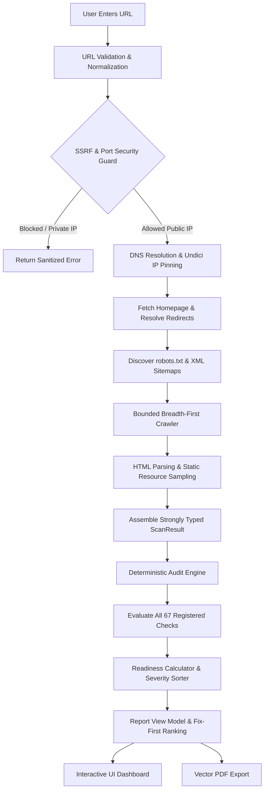

# Website Readiness Checker

> **One URL. One Scan. One Clear Answer.**
>
> Automated pre-launch QA and website readiness platform.

Website Readiness Checker evaluates whether a website is ready for public release. Given a target URL, it performs a bounded crawl, inspects pages and selected assets, runs a deterministic audit across 67 checks, and presents an actionable readiness report.

---

## Table of Contents

- [Key Features](#key-features)
- [How It Works](#how-it-works)
- [Architecture](#architecture)
- [Audit Engine & The 67-Check Invariant](#audit-engine--the-67-check-invariant)
- [Security Architecture](#security-architecture)
- [Privacy & Data Handling](#privacy--data-handling)
- [Phase 5 and Project Documentation](#phase-5-and-project-documentation)
- [Scanner Boundaries & Limits](#scanner-boundaries--limits)
- [Tech Stack](#tech-stack)
- [Project Structure](#project-structure)
- [API Reference](#api-reference)
- [Health & Readiness Endpoint](#health--readiness-endpoint)
- [PDF Report Generation](#pdf-report-generation)
- [Local Development](#local-development)
- [Environment Variables](#environment-variables)
- [Production Build and Lifecycle](#production-build-and-lifecycle)
- [Testing Strategy](#testing-strategy)
- [Known Limitations](#known-limitations)
- [Current Production-Readiness Status](#current-production-readiness-status)
- [Contributing](#contributing)
- [License](#license)

---

## Key Features

- **Automated Bounded Crawling**: Discovers internal pages via on-page links, XML sitemaps, and `robots.txt` directives while staying strictly within the target domain.
- **67 Deterministic Audit Checks**: Strict launch evaluation spanning Technical QA, Crawlability, SEO, Asset Health, Performance, Security Headers, and Accessibility.
- **Three-Tier Readiness Verdicts**:
  - `READY`: 0 critical blockers and 0 important defects.
  - `REVIEW REQUIRED`: 0 critical blockers, but 1 or more important quality issues need review.
  - `NOT READY`: 1 or more critical blockers must be resolved prior to launch.
- **Fix First Priority Ranking**: Algorithmic ranking identifying top high-impact issues to address first.
- **Launch QA Checklist**: Interactive, actionable list of remediation steps for developers and QA engineers.
- **Real-Time Streaming**: Server-Sent Events (SSE) stream scan progress stages (`validating`, `connecting`, `crawling`, `analyzing`) live to the client.
- **Vector PDF Export**: Generates client-side, multi-page vector PDF reports with summary metrics, tables, and colored badges without rasterization or canvas capture.
- **Coverage Transparency**: Accurately tracks analyzed pages against discovered pages (e.g., full coverage vs. bounded partial coverage).
- **Responsive & Accessible UI**: Keyboard navigation, WCAG 2.3.3 reduced-motion support, accessible form labels, skip links, and ARIA live progress announcements.
- **Incremental Audits**: Continues eligible audits in separate bounded executions and merges page, coverage, and finding data.

---

## How It Works



1. **Input & Validation**: The user provides a URL. The system normalizes the scheme and hostname, strips userinfo credentials, and verifies syntax.
2. **Security & DNS Guard**: The domain is resolved and verified against private IPv4/IPv6 ranges, loopback, and cloud metadata. The public IP is pinned to prevent DNS rebinding (TOCTOU).
3. **Crawl & Discovery**: `robots.txt` and XML sitemaps are fetched. Internal links are enqueued up to 50 pages and depth 3.
4. **Parsing & Resource Sampling**: HTML documents are parsed for metadata, headings, canonicals, links, images, language, and viewport tags. Up to 5 static assets per page are sampled for HTTP status, content type, and cache headers.
5. **Audit Execution**: The structured `ScanResult` is fed into the pure `AuditEngine`. All 67 registered checks execute in memory.
6. **Verdict & Reporting**: Findings are classified (`critical`, `important`, `improvement`, `passed`), a readiness verdict is computed, and the interactive report is presented with optional PDF download.

---

## Architecture

The project is structured into distinct, decoupled subsystems:

```text
├── server.ts               # Express backend, API routing, SSE streaming, graceful shutdown
├── src/
│   ├── scanner/            # HTTP crawling, network security, DNS safety, HTML parsing
│   ├── audit/              # Deterministic audit engine, check registry, readiness rules
│   ├── report/             # Presentation view-models, fix-first ranking, vector PDF export
│   ├── components/         # React presentation layer, report dashboard, forms, modals
│   ├── utils/              # Client-side router and navigation helpers
│   ├── App.tsx             # Main client shell with skip link and view router
│   └── main.tsx            # Client DOM entry point
```

### Component Responsibilities

- **`src/scanner/`**:
  - `url-validator.ts`: Normalization, hostname resolution, port extraction, userinfo stripping.
  - `security-guard.ts`: Enforces port allowances (`80`, `443`) and blocks private, reserved, loopback, and metadata destinations.
  - `dns-safety.ts`: Validates all DNS answers and pins verified IP addresses to the Undici HTTP connection.
  - `fetcher.ts`: Bounded HTTP requests with per-request timeouts, response caps, manual redirect validation, and sensitive-header filtering.
  - `parser.ts`: Streaming HTML parser extracting metadata, headings, links, images, resources, and accessibility attributes.
  - `crawler.ts`: Bounded breadth-first crawl queue restricted to same-site domain.
  - `robots.ts` & `sitemap.ts`: RFC 9309 robots parser and XML sitemap extractor.
  - `rate-limiter.ts`: In-memory concurrency limiter (max 3 concurrent scans, 15 scans / 5 min).
  - `scan-orchestrator.ts`: Pipeline coordinator emitting typed progress events.
- **`src/audit/`**:
  - `registry.ts`: Registry managing all 67 audit checks.
  - `engine.ts`: Pure evaluation pipeline over supplied scan data; audit evaluation performs no network requests.
  - `readiness.ts`: Mathematical verdict calculator.
  - `checks/`: Individual check definitions grouped by category.
- **`src/report/`**:
  - `view-model.ts`: Transforms audit and scan data into view models.
  - `fix-first.ts`: Priority ordering algorithm for urgent fixes.
  - `checklist.ts`: Launch QA checklist generator.
  - `pdf-export.ts`: Vector PDF generation using `jsPDF` and `jspdf-autotable`.
  - `session.ts`: Coverage accounting and deduplication.

### Phase 5 and Project Documentation

Phase 5 and the final local readiness verification are documented in [`docs/`](./docs/):

- [Verified phase history](./docs/phase-history.md)
- [Architecture](./docs/architecture.md)
- [Security and privacy](./docs/security.md)
- [Testing and verification](./docs/testing.md)
- [Production readiness and limitations](./docs/production-readiness.md)
- [Phase 5 implementation record](./docs/phases/phase-5-security-privacy-production.md)

---

## Audit System & The 67-Check Invariant

The audit engine enforces a strict invariant: **exactly 67 registered checks** are evaluated for every scan. Every registered check deterministically produces an evaluated finding (or explicit pass) under all markup and network conditions.

### Category Breakdown

| Category | Checks | Focus Areas |
| :--- | :---:| :--- |
| **Technical QA** | 11 | Site reachability, HTTP status, HTTPS availability, redirect loops, 5xx errors, staging/localhost leaks, critical page status. |
| **Crawlability** | 14 | Robots.txt existence/syntax, XML sitemap validity/accessibility, broken sitemap URLs, noindex conflicts, protocol mismatches, crawl depth, canonical alignment, redirect chains, duplicate URL signals. |
| **SEO** | 17 | Title presence/length/uniqueness, meta descriptions, H1 presence/structure, heading hierarchy, canonical tags, Open Graph tags, favicon, structured data. |
| **Asset Health** | 6 | Broken resources (4xx/5xx), missing/empty image alt text, oversized images (>1 MB), mixed HTTP content, missing image dimensions. |
| **Performance** | 7 | Server response time, HTML payload size, total page weight, resource request count, large JS bundles, HTTP compression (gzip/brotli), Cache-Control headers. |
| **Security** | 6 | Strict-Transport-Security (HSTS), Content-Security-Policy (CSP), X-Content-Type-Options, X-Frame-Options, Referrer-Policy, Permissions-Policy. |
| **Accessibility** | 6 | Viewport configuration, HTML language declaration, duplicate element IDs, unlabeled form controls, iframe titles, empty anchor links. |
| **Total** | **67** | **Deterministic launch readiness evaluation** |

### Unsupported Checks Disclosure
The engine explicitly documents checks that cannot be evaluated by design rather than fabricating answers:
- `tech-ssl-cert-validity`: Requires native TLS socket inspection not exposed by HTTP streaming abstractions.
- `crawl-external-links-deep`: Excluded to maintain same-site SSRF security boundaries.
- `perf-core-web-vitals`: Requires a full headless browser rendering engine (Chromium/Puppeteer), whereas this engine uses high-speed streaming HTTP parsing.

---

## Security Architecture

The scanner is designed to limit SSRF risk when fetching user-supplied URLs. This is not an absolute security guarantee:

- **SSRF & destination policy**: Rejects private, loopback, link-local, metadata, benchmarking, documentation, multicast, and reserved IPv4 ranges, as well as blocked IPv6 classes including mapped/compatible IPv4 and deprecated site-local IPv6.
- **DNS rebinding protection**: Validates every DNS answer and pins connections to verified IP addresses. Redirect destinations are revalidated before fetching.
- **Port Allowlist**: Strictly ports `80` (HTTP) and `443` (HTTPS) are permitted. All administrative, database, and internal service ports are rejected.
- **Bounded requests**: Enforces request, response/body, per-request timeout, and per-execution duration limits. Redirect hops and resource fallbacks count against the request budget.
- **Cancellation and shutdown**: Propagates client cancellation and server shutdown to active scan work and sends terminal SSE events where the stream remains writable.
- **Sanitized Errors**: System stack traces, internal paths, and socket exceptions are intercepted and converted into sanitized user-friendly messages.
- **HTTP Header Hardening**: Express disables `X-Powered-By` and injects `X-Content-Type-Options: nosniff` and `Referrer-Policy: strict-origin-when-cross-origin`.

---

## Privacy & Data Handling

- **In-Memory Storage Only**: The server retains up to 50 recent raw scans in process memory. There is no persistent SQL or NoSQL database; a restart clears retained scans.
- **Cryptographic Scan IDs**: Scan identifiers use cryptographically secure UUIDv4 (`scan-${crypto.randomUUID()}`).
- **Sensitive Header Filtering**: Inbound response headers (`Set-Cookie`, `Cookie`, `Authorization`, `Proxy-Authorization`) are stripped before scan data is stored.
- **No-Store API Responses**: All scan and audit API endpoints enforce `Cache-Control: private, no-store, no-cache, must-revalidate`.

---

## Scanner Boundaries & Limits

All scanner operations import and strictly adhere to centralized boundaries:

| Boundary | Value | Description |
| :--- | :---:| :--- |
| **Maximum pages** | `50` | Maximum internal pages crawled per scan execution/batch |
| **Maximum crawl depth** | `3` | Maximum link depth from the homepage |
| **Maximum redirects** | `5` | Maximum redirect hops followed per request |
| **Maximum total requests** | `150` | Per-execution HTTP request budget across pages, robots.txt, sitemaps, and assets, including redirect hops and resource HEAD/GET attempts |
| **Request timeout** | `8,000 ms` | Per-request network timeout |
| **Maximum scan duration** | `60,000 ms` | Execution-level timeout; continuation batches get independent deadlines and merged reports sum their durations |
| **Maximum response size** | `3,145,728 B` (3 MB) | Maximum bytes read for any single HTTP response |
| **Maximum HTML size** | `2,097,152 B` (2 MB) | Maximum bytes parsed for an HTML document |
| **Maximum sitemap URLs** | `250` | Maximum URLs extracted from XML sitemaps |
| **Allowed ports** | `[80, 443]` | Strictly HTTP and HTTPS ports |
| **Resource sampling cap** | `5` | Maximum static assets sampled per page |
| **Concurrent scans** | `3` | Maximum simultaneous scans system-wide |
| **Rate limit** | `15 / 5 min` | Maximum scan requests per IP per 5-minute window |

---

## Tech Stack

- **Runtime & Language**: Node.js and TypeScript (see `package.json` and the installed toolchain)
- **Backend Framework**: Express 4.21
- **HTTP Client**: Undici 8.11 (with custom IP-pinned dispatcher)
- **Frontend Framework**: React 19, React DOM 19
- **Build Tooling**: Vite 8.3, esbuild 0.28, Tailwind CSS v4
- **PDF Generation**: jsPDF 4.2, jspdf-autotable 5.0
- **Icons**: Lucide React
- **Test Runner**: Node.js native test runner (`node:test`) executed via `tsx`

---

## Project Structure

```text
website-readiness-checker/
├── server.ts                       # Express server, API routes, lifecycle & shutdown
├── vite.config.ts                  # Vite build configuration with Tailwind CSS
├── tsconfig.json                   # TypeScript configuration
├── package.json                    # Scripts and dependencies
├── .env.example                    # Environment variable template
├── docs/                           # Architecture, security, testing and readiness records
├── metadata.json                   # Application metadata
├── index.html                      # HTML entry point with accessibility & fonts
├── src/
│   ├── App.tsx                     # Client root component with routing & skip links
│   ├── main.tsx                    # Client entry point
│   ├── index.css                   # Tailwind imports & prefers-reduced-motion
│   ├── types.ts                    # UI & shared types
│   ├── scanner/                    # Core scanning & network engine
│   │   ├── crawler.ts              # Bounded breadth-first crawler
│   │   ├── dns-safety.ts           # DNS resolution & IP pinning
│   │   ├── errors.ts               # Sanitized error model & exceptions
│   │   ├── fetcher.ts              # Undici-based safe HTTP fetcher
│   │   ├── limits.ts               # Centralized limits (50 pages, 150 reqs, etc.)
│   │   ├── parser.ts               # Streaming HTML parser
│   │   ├── rate-limiter.ts         # In-memory concurrency & burst limiter
│   │   ├── redirect-handler.ts     # Safe redirect tracker
│   │   ├── resource-analyzer.ts    # Static asset sampler
│   │   ├── robots.ts               # RFC 9309 robots parser
│   │   ├── scan-orchestrator.ts    # Pipeline orchestrator
│   │   ├── security-guard.ts       # SSRF & port validator
│   │   ├── sitemap.ts              # XML sitemap parser
│   │   ├── store.ts                # In-memory scan store
│   │   └── types.ts                # Scanner data structures
│   ├── audit/                      # Deterministic audit engine
│   │   ├── engine.ts               # AuditEngine runner
│   │   ├── registry.ts             # 67-check registry
│   │   ├── readiness.ts            # Mathematical verdict calculator
│   │   ├── types.ts                # Audit findings & severity types
│   │   └── checks/                 # Individual check implementations
│   │       ├── accessibility.ts    # 6 accessibility checks
│   │       ├── assets.ts           # 6 asset health checks
│   │       ├── crawlability.ts     # 14 crawlability checks
│   │       ├── optional.ts         # Metadata & social checks
│   │       ├── performance.ts      # 7 performance checks
│   │       ├── security.ts         # 6 security header checks
│   │       ├── seo.ts              # 17 SEO & document checks
│   │       └── technical.ts        # 11 technical QA checks
│   ├── report/                     # Presentation & reporting
│   │   ├── checklist.ts            # Launch checklist generator
│   │   ├── comparison.ts           # Scan diffing logic
│   │   ├── fix-first.ts            # Priority ranking algorithm
│   │   ├── pdf-export.ts           # Vector PDF generator
│   │   ├── session.ts              # Coverage calculator
│   │   ├── types.ts                # View-model interfaces
│   │   └── view-model.ts           # Report view-model builder
│   └── components/                 # React UI components
│       ├── FindingCard.tsx         # Finding card with code evidence
│       ├── Hero.tsx                # Hero section with URL input
│       ├── Navbar.tsx              # Top navigation bar
│       ├── Footer.tsx              # Application footer
│       ├── UrlScanInput.tsx        # Accessible scan form with live progress
│       └── report/                 # Report views & modals
│           ├── AuditSummarySection.tsx
│           ├── ComparisonView.tsx
│           ├── FindingList.tsx
│           ├── FixFirstSection.tsx
│           ├── LaunchChecklist.tsx
│           ├── ReadinessHeader.tsx
│           ├── ReportFilters.tsx
│           └── ReportPage.tsx
└── test/                           # Unit, regression, and integration tests
```

---

## API Reference

### 1. Health & Readiness
- **Path**: `GET /api/health` or `GET /health` (supports `HEAD`)
- **Headers**: Returns `Cache-Control: no-cache, no-store, must-revalidate`
- **Response** (`200 OK`):
  ```json
  {
    "status": "ok",
    "service": "website-readiness-checker",
    "version": "1.0.0",
    "timestamp": "2026-09-29T12:00:00.000Z",
    "activeScans": 0,
    "rateLimiter": {
      "activeScans": 0,
      "trackedClients": 0
    }
  }
  ```
- **Shutdown Response** (`503 Service Unavailable`):
  ```json
  {
    "status": "shutting_down",
    "service": "website-readiness-checker",
    "timestamp": "2026-09-29T12:00:00.000Z"
  }
  ```

### 2. Initiate Scan
- **Path**: `POST /api/scan`
- **Body**:
  ```json
  {
    "url": "https://example.com",
    "stream": true
  }
  ```
- **SSE Stream Mode** (`stream: true`):
  - Emits real-time SSE events:
    - `progress`: `{ "stage": "crawling", "message": "...", "stepNumber": 3 }`
    - `completed`: Full `ScanResult` JSON payload.
    - `cancelled`: `{ "message": "Scan cancelled by client." }`
    - `scan_error`: Sanitized error payload.
    - `server_shutdown`: `{ "message": "Server is shutting down." }`
- **Standard Mode** (`stream: false`):
  - Returns `ScanResult` JSON directly.

### 3. Get Scan Data
- **Path**: `GET /api/scan/:id`
- **Response**: Full `ScanResult` object or `404 Not Found`.

### 4. Get Audit Result
- **Path**: `GET /api/audit/:id`
- **Response**: Pure deterministic `AuditResult` containing readiness status, summary counts, and all 67 evaluated check findings.

---

## PDF Report Generation

PDF export is implemented in `src/report/pdf-export.ts` using `jsPDF` and `jspdf-autotable`.

- **Pure Vector Generation**: Generates native vector text, geometries, and tables directly. Does not rely on canvas rasterization (`html2canvas`) or browser screenshots.
- **Client-Side or Server-Side**: Runs directly in the browser via client triggers or headlessly in Node.js.
- **Report Contents**:
  - Target URL, domain, scan timestamp, and scan ID.
  - Prominent Readiness Verdict badge (`READY`, `REVIEW REQUIRED`, `NOT READY`).
  - Key Metrics Table (total checks, passed, defects, pages crawled, data transferred).
  - Fix First Priority Table (top blockers with specific remediation advice).
  - Launch QA Checklist (status of essential release criteria).
  - Detailed Findings Table categorized with severity indicators.
  - Document footer with "Page X of Y" pagination.

---

## Local Development

### Prerequisites
- Node.js `^20.19.0` or `>=22.12.0` (Vite 8 requirement) and npm; verification was run with Node.js `22.23.2` and npm `10.9.8`.

### Setup Commands

```bash
# Install dependencies
npm install

# Start Express with Vite middleware
npm run dev
```

The development server defaults to port `3000`; the actual port can be changed with `PORT`. `.env.example` is a reference template; the server does not explicitly load `.env` files, so set runtime values in the shell or host environment.

```bash
# TypeScript check
npm run lint

# Run all test files (review external-network tests before running)
npm test

# Build client and server bundles locally
npm run build
```

`npm test` expands to every `test/**/*.test.ts` file. Some historical integration/e2e tests may perform external network activity; see [Testing and verification](./docs/testing.md) and review those tests before running the unrestricted script.

## Environment Variables

The server reads `PORT`, `NODE_ENV`, `TRUST_PROXY`, and `DISABLE_HMR`. `.env.example` also lists `APP_URL`, which is currently not read by the server or Vite configuration.

| Variable | Default | Description |
| :--- | :--- | :--- |
| `PORT` | `3000` | Express server port; the server listens on `0.0.0.0`. |
| `NODE_ENV` | Runtime-dependent | `production` selects static production serving; test detection prevents the server from starting during tests. |
| `TRUST_PROXY` | `false` | When `true` or `1`, uses the first `X-Forwarded-For` value for rate-limit identity. Enable only behind a correctly configured trusted proxy. |
| `DISABLE_HMR` | `false` | Disables Vite HMR and file watching when set to `true`. |
| `APP_URL` | `http://localhost:3000` in the template | Present in `.env.example`; no current application use was found. |

## Production Build and Lifecycle

The production build compiles the client into `dist/` and bundles `server.ts` as `dist/server.cjs`:

```bash
npm run build
npm start
```

These are local build and run instructions only; they do not indicate that the application has been deployed. On `SIGTERM` or `SIGINT`, the server marks itself as shutting down, emits `server_shutdown` to active SSE streams where possible, aborts active scans, and closes the HTTP listener within a bounded wait.

## Testing Strategy

The test suite uses Node's native test runner through `tsx`. Test files cover the audit engine, scanner security and limits, incremental sessions, report routing and PDF generation, SSE handling, and server lifecycle. The unrestricted `npm test` script includes all test files; avoid running tests that perform external requests when verifying without network access.

The latest safe audit ran 16 selected test files and separately ran the IPv4 `198.18.0.0/15` case from `scanner.test.ts`. All selected files and the isolated case passed. The safe selection excluded `phase5-2-privacy-fixes.test.ts`, `phase5-5-e2e-user-journey.test.ts`, and the full `scanner.test.ts`. See [Testing and verification](./docs/testing.md) for the exact selection and prior results.

## Known Limitations

- **Per-execution limits**: Page, request, and duration limits apply to each scan execution/batch. Continuation batches get independent budgets; merged reports sum their recorded totals. Session-wide cumulative request/time caps are not implemented.
- **Native DNS cancellation**: The scan stops waiting for DNS when its abort/deadline signal fires, but Node's underlying `dns.lookup` operation cannot be directly cancelled and may complete asynchronously.
- **Large build chunk**: The production build reports a non-failing warning for a minified JavaScript chunk larger than 500 kB.
- **In-memory retention**: Server scans and browser audit-session state are in memory and do not survive process/page lifecycle resets; server raw scan retention is limited to 50 recent results.
- **Bounded, static inspection**: The crawler is same-site and bounded. It parses fetched HTML without executing client-side JavaScript, so content rendered only in a browser may not be represented.

For the current audited status and residual risks, see [Production readiness](./docs/production-readiness.md).

## Current Production-Readiness Status

The final safe Phase 5 audit classified the project **A — PRODUCTION READY** for a local pre-deployment readiness assessment. This status does not mean that a deployment has occurred. See [Production readiness](./docs/production-readiness.md) for scope and remaining limitations.

---

## Contributing

1. Clone or fork the repository.
2. Install dependencies: `npm install`.
3. Create a local branch for your changes: `git checkout -b feature/my-feature`.
4. Ensure all code conforms to strict TypeScript: `npx tsc --noEmit`.
5. Run the test suite: `npm test`.
6. Run the production build: `npm run build`.
7. Submit a pull request with a concise summary of changes and test evidence.

---

## License

Licensing information has not yet been specified for this project.
